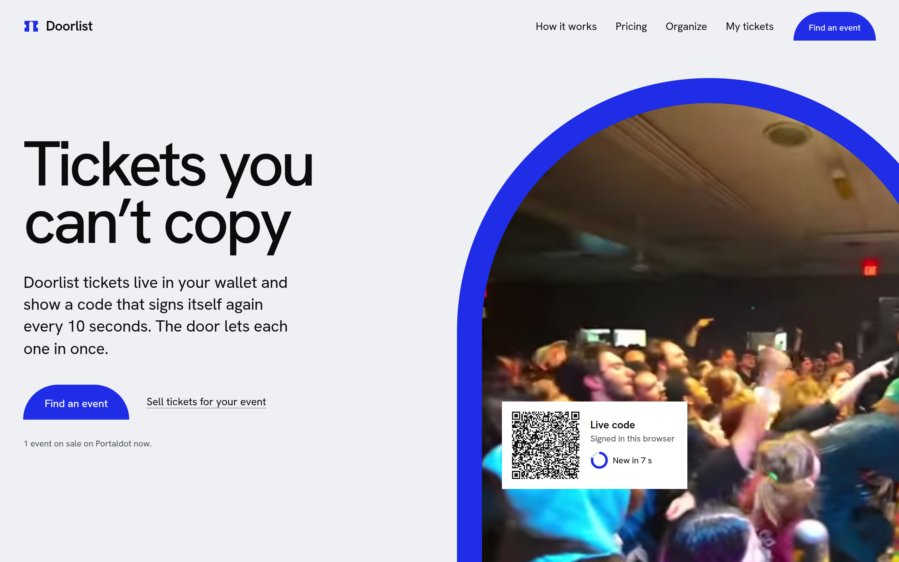
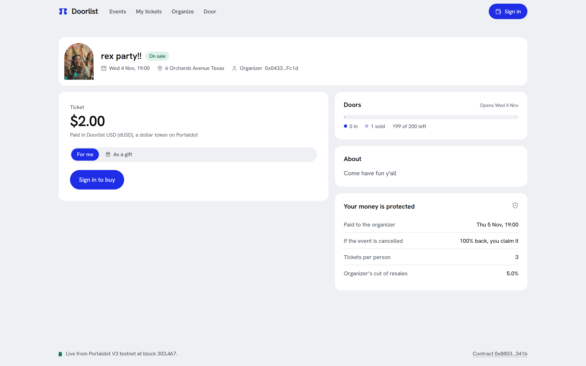

# Doorlist

**Event tickets that live in your wallet, get paid for in a stablecoin, and show a QR code that re-signs itself every 10 seconds, so a screenshot, a forwarded PDF or a second scan is refused at the door.**

[Live app](https://door-list.vercel.app) · [Architecture](docs/architecture.md) · Contract `0x880399CA1D25DD105bb42c82F281245f76b2341b` on Portaldot V3 testnet



Built for Portaldot Hacker House 2026, Ecosystem DApps track, on Portaldot V3: Solidity on `pallet_revive`, a native stablecoin through the assets precompile, event media in `transactionStorage`, and sign-in with the official Portaldot Wallet.

---

## The problem

You buy a ticket and get a QR code in an email. That code is a row in someone's database, and anything that can be screenshotted can be sold twice. At the door, the first copy in wins and the real owner is turned away.

The numbers say this is not rare. UK ticket fraud losses reached £9.7 million in 2024, up 47% in a year ([Action Fraud, via LBC](https://lbc.co.uk/business/d44783f0e72547b398fcf0e3eb88c773)). In one survey, 26% of people who bought from unofficial sellers received a fake ([Surfshark](https://surfshark.com/research/chart/fake-event-tickets)). And the market is large: analyst estimates for online event ticketing in 2025 run from about $43 billion ([Straits Research](https://straitsresearch.com/report/online-event-ticketing-market)) to $85 billion a year.

Crypto has not fixed this, even at crypto events. Some conferences take crypto at checkout ([Devcon's ticket shop](https://tickets.devcon.org/) sells for ETH), but the ticket you receive is still a code in an email. Paying in crypto was never the gap. **The ticket itself was never on a chain.**

## What we built

An organizer creates an event: name, date, price in dUSD (a dollar stablecoin on Portaldot) or POT, capacity, a per-person limit and a picture. Buyers pay from their wallet, for themselves or as a gift to a friend. The ticket is a token owned by that wallet.

At the venue, the guest opens the ticket on their phone. The wallet approves that phone once, and from then on the phone signs a fresh code every 10 seconds. The door phone checks the signature, the age of the code and the chain, then records the entry on-chain. **First scan: VALID. Same code again, or a screenshot older than 30 seconds: REFUSED.**



## How Doorlist uses Portaldot

| Portaldot feature | Role in Doorlist | Where |
|---|---|---|
| `pallet_revive` (Solidity) | The ticket registry, escrow, resale and check-in rules | [`contracts/contracts/Doorlist.sol`](contracts/contracts/Doorlist.sol) |
| `revive.call` from 5... accounts | Every action from the official Portaldot Wallet, dry-run first with `reviveApi.call` | [`web/lib/substrate.ts`](web/lib/substrate.ts) |
| `pallet_assets` + ERC-20 precompile | dUSD, a native asset (id 2026) the contract settles in | [`web/lib/chain.ts`](web/lib/chain.ts), [`scripts/stablecoin.mjs`](scripts/stablecoin.mjs) |
| `transactionStorage` | Event pictures and descriptions stored on the chain itself, hash-checked on read | [`web/lib/media.ts`](web/lib/media.ts) |
| `revive.originalAccount` | The door verifies a Portaldot Wallet's sr25519 signature against the ticket owner's 5... account | [`web/lib/pass.ts`](web/lib/pass.ts) |

**Two wallets, one contract.** The official Portaldot Wallet exposes only Substrate (5...) accounts, so Doorlist calls the Solidity contract with `revive.call` extrinsics signed in the extension. Ethereum-style wallets such as Rabby use the EVM RPC. Both reach the same tickets.

**A note on what we found.** Portaldot's Ethereum RPC only indexes Ethereum-style transactions: anything sent as a `revive.call` has no logs in `eth_getLogs`. An event created from the Portaldot Wallet simply did not appear. Doorlist now reads events and tickets from contract storage, and recovers an event's media link from that block's `revive.ContractEmitted` events, found by a binary search over historical `eth_call` ([`web/lib/doorlist.ts`](web/lib/doorlist.ts)).

## How it works

```text
 Guest wallet ──buy (dUSD)──►  Doorlist.sol  ◄──checkIn── Door phone (own key)
      │                        events[], tickets[]            ▲
      │ signs a pass once      escrow until event + 24h       │ scans
      ▼                                                       │
 Guest phone ── signs ticketId + time every 10 s ── QR ───────┘
```

1. The organizer creates the event; pictures go into `transactionStorage` first.
2. The organizer approves a door phone, which gets its own key and 1 POT for check-in fees.
3. A buyer pays; the price sits in escrow until 24 hours after the event starts.
4. The door accepts a code only if the owner's wallet approved that phone, the code is under 30 seconds old, and the ticket is unused. Then `checkIn` marks it used on-chain, so two doors cannot admit it twice.
5. Resale happens only inside Doorlist: the old token is burned and a new one minted, so old codes die. Doorlist takes 3%, the organizer a royalty of 0 to 10%.
6. If the event is cancelled, every holder claims 100% back from escrow, and the organizer can never withdraw.

## Try it

Open [door-list.vercel.app](https://door-list.vercel.app) with the [Portaldot Wallet](https://www.portaldot.world) and a 5... account holding testnet POT (about 20 POT covers a ticket and its storage deposit). On an event, **Get 100.00 dUSD** claims test dollars from our faucet, once per account.

Run it locally (Node 20+; the app reads the live testnet contract, no keys needed):

```bash
git clone https://github.com/mikemoulder/doorlist && cd doorlist/web
npm install
npm run dev        # http://localhost:3000
```

Contract tests: `cd contracts && npm install && npx hardhat test` (21 tests).

## What is real, what is not

**Real, on Portaldot V3 testnet:** both contracts, dUSD as a native asset, the faucet, event media in `transactionStorage`. With the Portaldot Wallet in a browser we have created an event, claimed dUSD, bought a ticket and approved a door.

**Test money:** dUSD is a stablecoin we created for the demo (asset 2026). It is not backed by anything.

**Not built yet:** renewing event pictures after about 7 days (`transactionStorage` expiry), a Pinata backup copy, a native mobile app, mainnet.

**Limits worth knowing:** storage deposits cost real testnet POT (up to about 15 per ticket, 20 per event). Resale prices are not capped, only routed through Doorlist with a royalty. A Portaldot Wallet event's picture takes about 20 seconds on a first visit, then is cached. Fees go to a treasury address we control.

## Roadmap

**Built:** create, buy, gift, resell, cancel and refund, door approval and check-in, two wallet paths, on-chain media.
**Next:** picture renewal and a Pinata backup, an "Open in Portaldot Wallet" link for phones, 5... addresses shown everywhere.
**Vision:** a door scanner app for organizers, and organizer-set resale caps.

---

Built by [@mikemoulder](https://github.com/mikemoulder) at Portaldot Hacker House 2026.
